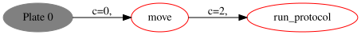
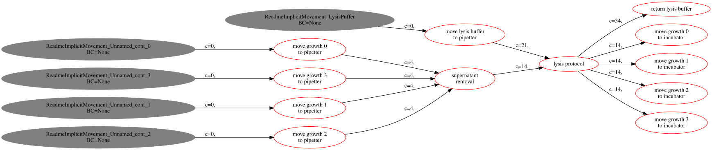
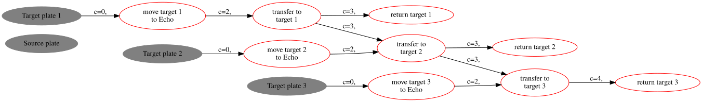
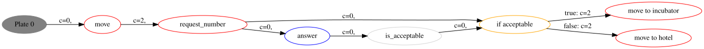
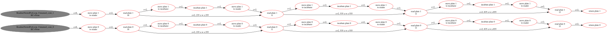
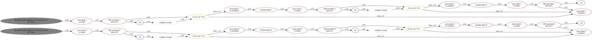
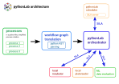

# pythonLab

This is the specification and development repository of
**pythonLab**, a universal, extendable and safe language for laboratory processes.
Since this process language needs many characteristics of a programming language, like conditions (if ...), loops (for/while), variables, etc. we do not want to re-invent the wheel twice but rather use the **python syntax**, which is very popular in science.

Also processes are defined in python, they are not **excecuted** but **parsed into directed graphs** 

## Examples

### Simple linear workflow

``` python
protocol_path = "protocols/evacuation_speroids.lhc"
self.robot_arm.move(cont, self.dispenser)
self.dispenser.run_protocol(labware=cont, protocol=protocol_path)
```

This process is parsed into the following workflow graph:



### Implicit movements for reagents and multi labware steps

``` python        
bravo_positions = [4, 6, 7, 8]
for i in range(len(growth_plates)):
    self.robot_arm.move(cont, target_loc=self.pipetter, lidded=False, position=bravo_positions[i])
self.pipetter.executeProtocol(growth_plates[0], protocol=sup_rem_protocol, duration=200,
                              reagents=growth_plates[1:],
self.pipetter.executeProtocol(growth_plates, protocol=lysis_protocol, duration=240,
                            reagents=[self.lysis_buffer],
                            reagent_pos=[3])          
for cont in growth_plates:
    self.robot_arm.move(cont, self.incubator2, lidded=True)                           
```

The reagent plates in `reagents=[...]` are moved to and from the liquid handler implicitly:



### Simple for-loop

``` python
for plate in self.target_plates:
    self.robot_arm.move(plate, self.echo, role="destination", read_barcode=True, lidded=False)
    self.echo.execute_transfer_protocol(self.source_plate, plate, protocol)
    self.robot_arm.move(plate, self.hotel2, lidded=True)
```

This process is parsed into the following workflow graph:



### Single conditional

``` python
def is_acceptable(answer) -> bool:
    return answer.Response.value >= 5

cont = self.containers[0]
self.robot_arm.move(cont, self.human)
answer = self.human.request_number(cont, message="assign quality score")
acceptable = self.is_acceptable(answer)
if acceptable:
    self.robot_arm.move(cont, self.incubator1)
else:
    self.robot_arm.move(cont, self.hotel1)
```

This process is parsed into the following workflow graph:



### Nested for-loop and timing comstraints

``` python
meas_time = 65
meas_points = [0, 5, 15, 30]
for cont in self.containers:
    self.robot_arm.move(cont, self.reader)
    self.reader.single_read(cont, method="protocol", label=f"read_{cont.name}_{0}")
    for i in range(1, len(meas_points)):
        self.robot_arm.move(cont, self.incubator1)
        self.incubator1.incubate(cont, duration=10, temperature=295, shaking_frequency=400)
        self.robot_arm.move(cont, self.reader)
        wait = 60*(meas_points[i] - meas_points[i-1]) - meas_time
        self.reader.single_read(cont, method="protocol", label=f"read_{cont.name}_{i}",
                                relations=[("min_wait", f"read_{cont.name}_{i-1}", [wait]),
                                            ("max_wait", f"read_{cont.name}_{i-1}", [wait+20])
                                            ]
        )
    self.robot_arm.move(cont, self.hotel)
```

This process is parsed into the following workflow graph:



### Nested for-loop with conditional and break

``` python
# cultured plates in incubator 37°, 200rpm, 45-90 min until aver_OD is >= 0.4.
for cont in cultured_plates:
    for j in range(3):
        self.robot_arm.move(cont, target_loc=self.reader2, lidded=False)
        od = self.reader2.single_read(cont, method=od_600)
        if j < max_cult_intervals - 1:
            aver_od = self.compute_average(od)
            if aver_od > 0.4:
                break
            else:
                # incubate for another interval
                self.robot_arm.move(cont, target_loc=self.incubator2, lidded=True)
                self.incubator2.incubate(cont, duration=cult_time_interval, temperature=cult_temp,
                                         shaking_frequency=cult_shaking_freq)    
    self.robot_arm.move(cont, target_loc=self.pipetter, lidded=False, position=3)   
```


This process is parsed into the following workflow graph:




## Architecture of pythonLab

pythonLab processes are denoted in a python like syntax, but they are **not** directly executed by a *python interpreter*. They are rather parsed into a *workflow graph*, which can be used by a *Scheduler* to calculate 
an optimal schedule (=order of execution). This order of execution might be different from the initial notation. An *Orchestrator* executes then the schedule and supervises the device communication, e.g. to SiLA servers/devices.


